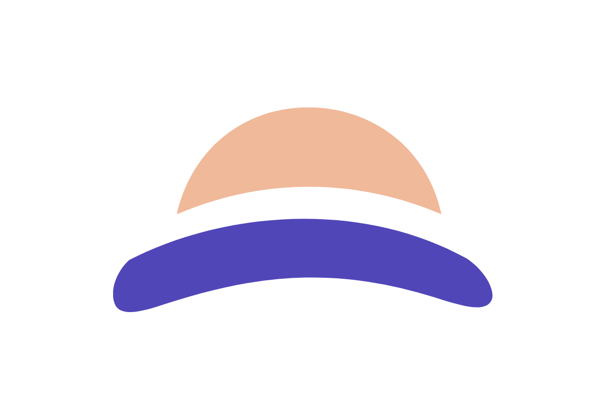

# MossCare for Android

Care for your everyday.

MossCare brings everyday self-care and access to professional support into one welcoming place.

## Download

**Current version: 0.1.3 (build 4) · Early Access**

**[Download MossCare for Android](https://github.com/philwamba/mosscare-downloads/releases/download/v0.1.3-build.4/mosscare-v0.1.3-build.4.apk)**

[Release notes and all versions](https://github.com/philwamba/mosscare-downloads/releases)

Requires **Android 8.0 or later**. Download the APK on your Android device, open it, and allow installation from your browser when Android prompts you.

This is an early-access release. MossCare is still being developed, and some features may be incomplete or unavailable. Sign-in, appointments, payments and calls have not yet completed live testing. Please read the release notes before using it.

Future versions will be available here. Install updates over your existing MossCare app to keep your data.

## About These Downloads

Each release includes the APK, a checksum file to help verify your download, and release details. App files are kept in [Releases](https://github.com/philwamba/mosscare-downloads/releases).

[Explore the MossCare project](https://github.com/philwamba/mosscare)

---

© 2026 MossCare. All rights reserved.
